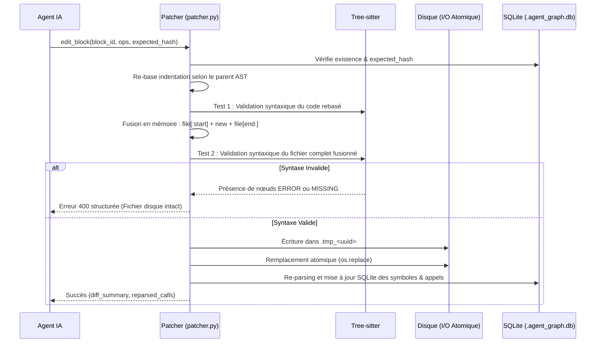

# Documentation Technique : AST Code-Graph MCP Server ("Scalpel")

## 1. Vue d'ensemble du Système

Le serveur **AST Code-Graph MCP Server** est un service local de développement implémentant le standard **Model Context Protocol (MCP)** sur le canal `stdio`. 

Il découple les agents d'intelligence artificielle (LLMs tels que Gemini, Claude ou GPT) de la manipulation classique de fichiers plats (`cat`, `grep`, `read_file`, `sed`) en exposant le code source sous forme de **graphe de nœuds syntaxiques interrogeable** (classes, méthodes, fonctions et dépendances d'appels).

```
┌────────────────────────────────────────────────────────┐
│               Agent IA (agy / Gemini / Claude)         │
└──────────────────────────┬─────────────────────────────┘
                           │ JSON-RPC (stdio)
┌──────────────────────────▼─────────────────────────────┐
│                 Couche Protocole MCP                   │
├────────────────────────────────────────────────────────┤
│ search_symbols │ read_block      │ search_documents    │
│ edit_block     │ insert_block    │ delete_block        │
│ build_context  │ get_project_map │                     │
├────────────────────────────────────────────────────────┤
│             Moteur de Graphe & Navigation AST          │
├──────────────────────────┬─────────────────────────────┤
│   Parseurs Tree-sitter   │    Base SQLite (WAL Mode)   │
│   (Python & TypeScript)  │  (Symboles, Appels, Spans)  │
├──────────────────────────┴─────────────────────────────┤
│         Patcheur Chirurgical Byte-Range & AST          │
├────────────────────────────────────────────────────────┤
│  Re-basage d'Indentation │ Barrière de Syntaxe Totale  │
└──────────────────────────┬─────────────────────────────┘
                           │ E/S Atomiques (.tmp -> replace)
┌──────────────────────────▼─────────────────────────────┐
│             Système de Fichiers Local Source           │
└──────────────────────────┴─────────────────────────────┘
```

### Objectifs Clés
* **Réduction Massif de Tokens (75% à 90%) :** Évite l'injection de fichiers entiers (1 000 à 10 000 tokens) lorsqu'une modification ne cible qu'une fonction de 30 lignes. Revendication d'origine **non mesurée** : `docs/AUDIT.md` §7.1 (« trois fois supérieur à l'écart mesuré ») et §7.5 (« Refuser »).
* **Optimisation de Latence (Anti-N+1 Calls) :** Récupère en un seul aller-retour réseau le corps complet de la cible et les contrats allégés (signatures, docstrings, appels) des dépendances appelées — par `read_block(paths=[...])` (plusieurs blocs en un appel) ou par `search_symbols(view="implementation")` (le contenu en ligne dans le résultat de la recherche).
* **Patch Chirurgical Déterministe :** Remplacement direct par plage d'octets UTF-8 sans réécriture globale (`ast.unparse` proscrit), garantissant l'intégrité des commentaires, du formatage et des lignes environnantes.
* **Support Multi-Agents Concurrent :** Partage d'une base SQLite persistante sur disque configurée en mode **WAL (Write-Ahead Logging)** avec contrôle de concurrence optimiste.

---

## 2. Modèle de Données & Persistance SQLite

La base SQLite est stockée à la racine de l'espace de travail dans `.agent_graph.db`.

### 2.1 Schéma Relationnel

```sql
-- Table principale des symboles extraits de l'AST
CREATE TABLE IF NOT EXISTS symbols (
    id TEXT PRIMARY KEY,               -- Identifiant qualifié, ex: "src/billing.py::BillingService.charge"
    file_path TEXT NOT NULL,           -- Chemin relatif POSIX normalisé, ex: "src/billing.py"
    parent_id TEXT,                    -- Symbole parent (classe englobante ou NULL)
    name TEXT NOT NULL,                -- Nom du symbole ("charge")
    kind TEXT NOT NULL,                -- 'function' | 'method' | 'class' | 'interface'
    signature TEXT NOT NULL,           -- Signature complète (ex: "def charge(self, user_id: str, amount: float) -> Receipt")
    docstring TEXT,                    -- Docstring extrait sans délimiteurs
    start_byte INTEGER NOT NULL,       -- Début du span en octets UTF-8 (inclus l'indentation de ligne et décorateurs)
    end_byte INTEGER NOT NULL,         -- Fin du span en octets UTF-8
    start_line INTEGER NOT NULL,       -- Numéro de ligne de début (1-indexé)
    end_line INTEGER NOT NULL,         -- Numéro de ligne de fin (1-indexé)
    content_hash TEXT NOT NULL,        -- Empreinte SHA-256 du code source du nœud
    updated_at TIMESTAMP DEFAULT CURRENT_TIMESTAMP
);

-- Table du graphe d'appels entre symboles
CREATE TABLE IF NOT EXISTS symbol_calls (
    caller_id TEXT NOT NULL,           -- Symbole appelant (clé étrangère -> symbols.id)
    callee_name TEXT NOT NULL,         -- Nom de la cible ("validate_user", "post_charge")
    call_expr TEXT NOT NULL,           -- Expression littérale ("self.validate_user", "self.gateway.post_charge")
    callee_symbol_id TEXT,             -- ID résolu ou candidat workspace du symbole appelé
    FOREIGN KEY(caller_id) REFERENCES symbols(id) ON DELETE CASCADE
);

-- Table du cache de staging pour les modifications différées
CREATE TABLE IF NOT EXISTS staged_changes (
    id TEXT PRIMARY KEY,
    file_path TEXT NOT NULL,
    symbol_id TEXT,
    action TEXT NOT NULL,              -- 'update' | 'insert' | 'delete' | 'import'
    content TEXT NOT NULL,
    created_at TIMESTAMP DEFAULT CURRENT_TIMESTAMP
);

-- Table des documents indexés (ontologie documentaire)
CREATE TABLE IF NOT EXISTS documents (
    id TEXT PRIMARY KEY,               -- chemin relatif POSIX, ex: "docs/spec.md"
    file_path TEXT NOT NULL,
    doc_type TEXT NOT NULL,            -- 'markdown' | 'docx' | 'pdf' | 'doc'
    title TEXT,                        -- titre du document
    section_count INTEGER NOT NULL DEFAULT 0,
    content_hash TEXT NOT NULL,
    updated_at TIMESTAMP DEFAULT CURRENT_TIMESTAMP
);

-- Table des paragraphes / sections de document
CREATE TABLE IF NOT EXISTS document_sections (
    id TEXT PRIMARY KEY,               -- "docs/spec.md#unity-catalog/archive-scratchpad-hygiene"
    document_id TEXT NOT NULL,
    heading TEXT NOT NULL,             -- titre du paragraphe
    level INTEGER NOT NULL DEFAULT 1,  -- niveau de titre (#, ##, Heading1, ...)
    order_index INTEGER NOT NULL,
    content TEXT NOT NULL,             -- texte du paragraphe (accès direct)
    content_hash TEXT NOT NULL,
    FOREIGN KEY(document_id) REFERENCES documents(id) ON DELETE CASCADE
);

-- Table des fichiers indexés (persistance : évite le reparse au redémarrage)
CREATE TABLE IF NOT EXISTS indexed_files (
    file_path TEXT PRIMARY KEY,
    content_hash TEXT NOT NULL,
    indexed_at TIMESTAMP DEFAULT CURRENT_TIMESTAMP
);

-- Index de recherche (BM25 FTS5) : sert uniquement à la notation de pertinence
CREATE VIRTUAL TABLE IF NOT EXISTS search_index USING fts5(
    kind UNINDEXED, ref_id UNINDEXED, file_path UNINDEXED, title, body,
    tokenize = 'unicode61'
);

-- Stockage optionnel d'embeddings (pertinence hybride BM25 + vecteurs)
CREATE TABLE IF NOT EXISTS embeddings (
    ref_id TEXT PRIMARY KEY, dim INTEGER NOT NULL, vector BLOB NOT NULL
);

-- Index d'optimisation
CREATE INDEX IF NOT EXISTS idx_symbols_file ON symbols(file_path);
CREATE INDEX IF NOT EXISTS idx_symbols_name ON symbols(name);
CREATE INDEX IF NOT EXISTS idx_calls_caller ON symbol_calls(caller_id);
CREATE INDEX IF NOT EXISTS idx_staged_file ON staged_changes(file_path);
```

### 2.2 Concurrence Multi-Agents & Verrouillage Optimiste
1. **Mode WAL (`PRAGMA journal_mode = WAL`)** :
   - Autorise une infinité de lecteurs simultanés pendant qu'un agent effectue une écriture.
   - Timeout de verrouillage configuré à 5 000 ms (`PRAGMA busy_timeout = 5000`).
2. **Verrouillage Optimiste (`expected_hash`)** :
   - Chaque symbole stocke un `content_hash` SHA-256.
   - Les outils de mutation acceptent un paramètre facultatif `expected_hash`. Si un agent B a modifié le symbole depuis la dernière lecture de l'agent A, l'opération est refusée avec une erreur explicite.
   - **Limite connue** : la vérification du hash et l'écriture ne sont pas atomiques (pas de compare-and-swap) ; deux agents strictement simultanés peuvent encore s'écraser mutuellement.

---

### 2.3 Indexation vs projection de contexte (découplées)

Deux phases distinctes :

1. **Indexation / ontologie** (`Indexer`) : extrait symboles et documents, persiste les hashes (table `indexed_files`) et alimente l'**index de recherche** (`search_index`, FTS5). C'est un travail **payé une seule fois**, incrémental ensuite.
2. **Projection de contexte** (`ContextBuilder` + `relevance.py`) : note les éléments pour une requête (BM25, ou fusion RRF BM25 + vecteurs si un `embedder` est fourni), puis remplit un **budget de tokens** en choisissant le **niveau de détail** de chaque élément :
   - niveau 0 : nom / chemin ;
   - niveau 1 : + type, signature ou titre ;
   - niveau 2 : + docstring ou niveau de titre ;
   - niveau 3 : + contenu complet (implémentation ou texte du paragraphe).

La stratégie est « largeur puis profondeur » : on liste d'abord beaucoup d'éléments au niveau 0 (fraction `breadth_ratio` du budget), puis on approfondit les mieux classés tant que le budget le permet. Le budget de sortie est donc **borné et pilotable**.

## 3. Moteur d'Analyse Syntaxique (Tree-sitter)

Le système utilise les liaisons officielles Tree-sitter pour générer un arbre de syntaxe concrète (CST) ultra-rapide en C.

### 3.1 Langages Pris en Charge
* **Python (`tree-sitter-python>=0.25.0`)** : extensions `.py`, `.pyi`.
* **TypeScript & JavaScript (`tree-sitter-typescript>=0.23.2`)** : extensions `.ts`, `.tsx`, `.js`, `.jsx`, `.mjs`, `.cjs`.
* **C# (`tree-sitter-c-sharp>=0.23.0`)** : extension `.cs`. Extraction des `namespace`, `class`, `struct`, `record`, `enum`, `interface`, méthodes, constructeurs et propriétés ; docstrings XML (`///`) ; appels via `invocation_expression` ; directives `using`.

### 3.2 Règles d'Extraction AST (Python)
* **Classes & Méthodes** :
  - Les définitions décorées (`decorated_definition`) sont capturées dans leur globalité : le span de début englobe les décorateurs (`@retry`, `@dataclass`).
  - L'indentation de ligne initiale est incluse dans le `start_byte` pour permettre des découpages sans décalage.
* **Signatures** : Extraites de `def` ou `class` jusqu'au caractère `:` marquant le début du bloc.
* **Docstrings** : Analyse du premier `expression_statement` contenant une chaîne du bloc, décodée proprement (guillemets triples supprimés).
* **Graphe d'Appels** : Parcours récursif du corps de la fonction avec capture de :
  - L'expression littérale : `self.gateway.post_charge`
  - Le nom de la cible nettoyé : `gateway.post_charge` (ou `validate_user` si préfixé par `self.`)
  - Résolution heuristique : recherche automatique dans la table `symbols` du workspace pour lier `callee_symbol_id`.

---

## 4. Gestion Intelligente de l'Indentation (AST-Driven)

L'un des pièges majeurs des agents LLM est la soumission de code sans indentation de classe (ex. méthode collée à la colonne 0). Le module [`IndentationManager`](file:///c:/CodeSource/Scalpel-mcp/src/ast_graph_server/indentation.py) résout ce problème de manière transparente.

### 4.1 Algorithme de Re-basage
1. **Détection du style du fichier** : Analyse automatique des espaces (2, 4, 8) ou tabulations.
2. **Détermination de la colonne cible** :
   - Pour une mise à jour (`edit_block`) : colonne de base du bloc existant, avec ré-ancrage sur `ast_depth x indent_step` pour une réécriture de bloc entier.
   - Pour une insertion dans une classe (`insert_block`) : colonne de la classe + pas d'indentation du fichier.
   - Pour une fonction de niveau module : colonne 0.
3. **Protection des chaînes multi-lignes** :
   - Tree-sitter identifie les nœuds `string` (Python) et `template_string` (TS/JS) multi-lignes ; la grammaire est choisie selon l'extension du fichier.
   - Les lignes internes de ces chaînes **ne subissent aucun décalage d'espaces**, préservant scrupuleusement la valeur textuelle littérale.

---

## 5. Pipeline de Patch Chirurgical & Barrières de Sécurité

Lors de l'appel à `edit_block` ou `insert_block`, le flux d'exécution garantit une intégrité absolue du disque :



### Règles d'Or du Patcheur
1. **Proscription d'`ast.unparse`** : La réécriture complète détruit le formatage manuel et les commentaires. Scalpel découpe strictement les octets UTF-8 d'origine.
2. **Barrière Syntaxique** : Le fichier complet reconstitué est validé avant tout accès disque (bloquant). La validation isolée du snippet n'est calculée qu'à titre de diagnostic : une méthode légitimement indentée n'est pas un module valide en soi.
3. **Atomicité OS** : Remplacement de fichier via `os.replace` depuis un fichier temporaire pour éviter toute corruption en cas de coupure.

---

## 6. Référentiel des Outils MCP

**Le serveur enregistre 8 outils MCP** (8 décorateurs `@self.mcp.tool` dans
`src/ast_graph_server/server.py`, lignes 418, 532, 601, 810, 889, 915, 1075, 1104). Cette section
décrit **cette surface-là** : chaque signature et chaque valeur par défaut ci-dessous est lue dans le
code, à la ligne indiquée. La surface que le modèle voit dans la campagne est la même, plus l'outil
`build` que le harnais ajoute (`benchmarks/toolsets.py`, `SCALPEL_SCHEMAS` + `BUILD_TOOL_SCHEMA`) —
**9 outils au total, un par ligne du tableau**. Ces faits sont tenus par
`tests/test_tool_surface_referential.py`, qui lit le registre vivant du serveur.

| # | outil (ligne du décorateur) | entrées | sortie |
| ---: | :--- | :--- | :--- |
| 1 | `search_symbols` (418) | `query`, `kind`, `path`, `limit`, `view`, `format` | texte (une ligne compacte par résultat) ou JSON |
| 2 | `read_block` (532) | `path` ou `paths`, `format` | texte numéroté + hash, ou liste complète des enfants |
| 3 | `edit_block` (601) | `path`, `ops`, `expected_hash`, `edits` | bloc numéroté mis à jour + nouveau hash |
| 4 | `insert_block` (810) | `parent`, `anchor`, `text` | état du bloc créé (id, texte numéroté, hash) |
| 5 | `delete_block` (889) | `path`, `expected_heading` | compte rendu de suppression + enfants remontés |
| 6 | `build_context` (915) | `query`, `budget_tokens`, `max_level`, `breadth_ratio`, `map_ratio`, `map_tokens`, `map_detail`, `map`, `min_score`, `precision`, `detail_level`, `format`, `max_entries_per_file`, `max_content_chars` | le contexte classé, prêt à injecter |
| 7 | `get_project_map` (1075) | `budget_tokens`, `path`, `format` | carte compacte budgetée |
| 8 | `search_documents` (1104) | `query`, `path`, `limit`, `full_top`, `include_content`, `format` | paragraphes trouvés, ou la liste des documents |
| 9 | `build` (harnais, `benchmarks/toolsets.py:199`) | aucun | « build ok » ou les erreurs du compilateur |

**Ce qui n'est plus un outil, et ne doit plus être décrit comme tel.** `insert_symbol`,
`delete_symbol`, `manage_imports`, `get_staged_diff`, `commit_staged_changes`,
`discard_staged_changes`, `inspect_symbols`, `list_documents`, `list_document_sections`,
`get_document_section`, `get_document_sections` **et le paramètre `stage_only`** n'apparaissent sur
aucune des deux surfaces. **`manage_imports`, la machinerie de staging et `imports.py` ont été entièrement
supprimés du dépôt le 03/10/2026 (`06ad388`).** Seuls `Patcher.insert_symbol` et `Patcher.delete_symbol`
survivent comme **méthodes internes privées du patcheur**, appelées par `insert_block` et `delete_block`.
Une capacité du patcheur n'est pas une capacité de la surface : c'est la confusion qui a rendu ce référentiel faux.

### 6.1 `search_symbols` — `server.py:418-530`

Recherche de symboles dans tout l'espace de travail ET dans les packages NuGet externes référencés
(`src/ast_graph_server/externals.py`, commit `a6bedc3`), avec **lecture en ligne facultative du résultat**.

* `query` *(string, **requis**)* — nom ou sous-chaîne.
* `kind` *(défaut `"all"`)* — `function`, `method`, `class`, `interface`, `namespace`, `struct`,
  `record`, `enum`, `property`, `constructor`, `destructor`, `operator`, `all`.
* `path` *(string, optionnel)* — **filtre glob** (ex. `"src/**/*.py"`). C'est le nom réel du paramètre ;
  `file_pattern` est mort.
* `limit` *(int, **défaut 50**)* — plafond du nombre de résultats renvoyés. C'est **le seul plafond** :
  une recherche `view="implementation"` en ligne **toutes** les implémentations qu'elle renvoie.
* `view` *(défaut `"none"`)* — `none`, `contract` (signature + docstring + appelants) ou
  `implementation` (le code source). Une vue `implementation` porte **les numéros de ligne et le
  `content_hash` que `edit_block` attend** : le bloc trouvé s'édite directement depuis le résultat.
* `format` *(défaut `"text"`)* — `text` ou `json`.

### 6.2 `read_block` — `server.py:532-598`

```
read_block(path=None, paths=None, format=None)
```

* `path` — **une seule adresse**. Trois cas : un dossier, un fichier de code ou un `.md` répond sa
  **liste complète d'enfants** (nom, portée de lignes, taille ; jamais le texte, jamais tronquée) ; un
  symbole ou un paragraphe répond son **texte numéroté à partir de 1**, l'indentation réelle, le
  `content_hash`, le `line_count` et le type de bloc ; un chemin de fichier n'est pas un bloc et le
  refus **nomme les blocs qu'il contient**. Un fichier de code porte aussi la région contiguë des
  `using` de tête comme enfant nommé `<fichier>.cs::using` (`parsers/csharp_parser.py:126-144`) :
  elle se lit et s'édite comme n'importe quel bloc.
* `paths` — **plusieurs blocs de texte en un appel** ; la réponse porte un bloc numéroté et son hash
  par entrée, donc N blocs coûtent un tour au lieu de N.
* `format` *(défaut `None`)* — ne gouverne **que le rendu d'une liste** ; à `None`, c'est le format
  configuré du serveur qui décide.

### 6.3 `edit_block` — `server.py:601-805`

```
edit_block(path=None, ops=None, expected_hash=None, edits=None)
```

Les quatre paramètres sont déclarés **facultatifs** (le serveur n'impose rien au niveau du schéma) et
c'est **le code qui juge la forme**, à l'appel : `edit_block_shape_refusal` (`server.py:789-797`) nomme
les clés reçues, celles en trop et celle qui manque à la forme la plus proche.

Deux formes, **jamais mélangées** :

* **un bloc** : `path` + `ops` ;
* **plusieurs blocs** : `edits=[{path, ops, expected_hash}, ...]`. Un `path` de tête accompagnant
  **une seule** entrée est **utilisé** pour elle (la réponse le dit) ; avec plusieurs entrées chacune
  porte le sien, et le refus nomme l'entrée qui n'en a pas.

**Le contrat des opérations est inchangé et vérifié** (`patcher.py:2343-2695`, `tests/test_lineops.py`) —
c'est la partie de l'ancien §6 qu'il fallait garder :

* `{"replace": [a, b], "content": "..."}` remplace la plage `[a, b]` : la plage est **INCLUSIVE**, la
  ligne juste à l'extérieur (`a-1` ou `b+1`) n'est pas consommée, donc un contenu qui la ré-émet
  laisserait le bloc la porter deux fois — cet edit est **refusé**, rien n'est écrit, les deux numéros
  sont nommés. Fusionner les changements adjacents en **une seule** opération.
* `{"delete": [a, b]}` supprime la plage.
* `{"insert_after": n, "content": "..."}` insère après la ligne `n` (`n=0` insère en tête). Un
  `insert_after` qui ré-émet une ligne déjà présente n'est **pas** refusé (il n'y a pas de plage à
  étendre) : la copie est écrite et signalée dans `warnings`. Un `insert_after` la **dernière** ligne
  du bloc écrit **dans le fichier** (le code devient un frère) : le bloc garde son hash et la réponse
  dit `written_outside_block` et renvoie la liste du fichier avec l'adresse de ce qui a été créé.
* **Application de bas en haut** (`patcher.py:3577`, `sorted(..., reverse=True)`) : une opération ne
  décale jamais celles qui restent à appliquer.
* **Les plages qui se chevauchent sont refusées** : `operations overlap: (1, 3) and (2, 4).` (vérifié
  en direct sur le serveur).
* `expected_hash` refuse l'édition si le bloc a bougé, et renvoie le bloc **frais** avec les numéros et
  le hash à réutiliser dans le même tour ; si le hash appartient à **un autre bloc**, le refus **nomme
  ce bloc** (un hash n'ouvre qu'un bloc).

**Atomicité du lot.** Une entrée qui casse la **syntaxe** fait refuser le **lot entier** : rien n'est
écrit pour aucune entrée, donc chaque `expected_hash` envoyé ouvre encore son bloc. Une entrée refusée
pour une **autre** cause laisse le reste appliqué. Dans les deux cas la réponse dit combien d'entrées
ont été appliquées — et quand `applied == 0`, elle dit que **rien** n'a été écrit.

**Structure : `edit_block` n'y touche pas.** Un titre de niveau inférieur ou égal à celui du bloc est
refusé (il scinderait le bloc, et la réponse ne décrirait plus qu'une moitié) ; au plus un nouveau
paragraphe plus profond par édition, rapporté dans `created_section_ids` ; renommer le titre du bloc
reste un edit ordinaire. Ajouter un paragraphe passe par `insert_block`.

**Il n'y a pas de `stage_only`.** Le paramètre n'existe sur aucune surface ; la machinerie de staging
survit dans le patcheur mais **aucun outil ne la commande**.

### 6.4 `insert_block`

```
insert_block(parent, anchor=None, text)
```

Trois paramètres, et rien d'autre :

* `parent` *(requis)* — le bloc qui reçoit l'enfant, écrit comme un **chemin** :
  - **un conteneur de type de code** (`module.py::NomDeClasse`, `T.cs::Namespace::Classe`) : insère une méthode, un champ ou une classe imbriquée dedans (avec alignement AST et indentation automatique) ;
  - un document Markdown (ses sections de tête) ou un paragraphe (`guide.md::Section mère::Paragraphe`) ;
  - un **dossier**, qui **crée** l'enfant dedans (fichier, ou dossier si la première ligne de `text` finit par `/`).
* `anchor` *(optionnel)* — l'id d'un **enfant de `parent`** pour insérer juste après lui (et après
  tout ce qu'il porte : un conteneur possède son sous-arbre). Omis, l'insertion se fait en **premier**
  enfant (ou en fin de corps de classe pour un conteneur de type sans anchor). Un `anchor` qui n'est pas un enfant direct est **refusé**, et le refus nomme le parent qui
  le tient et donne l'appel exact à refaire. `"start"`/`"end"` ne sont pas des valeurs de ce
  paramètre : ce sont des **ids morts** de l'ancien `where`.
* `text` *(requis)* — le nouveau bloc :
  - sous un conteneur de code : le code de la méthode, fonction ou classe à insérer ;
  - sous un document : **première ligne = titre**, le reste = le corps ;
  - sous un dossier : nom du fichier ou dossier à créer.

**La nature du parent décide de la syntaxe** : du code (C#, Python, etc.) sous une classe ou un fichier de code (la machinerie des
symboles `insert_symbol`), du Markdown sous un document, un nom sous un dossier.

**Le niveau et le numéro sont déduits, jamais demandés.** Le niveau est celui du parent **+ 1** ; le
numéro vient de l'enfant qui précède, et les enfants suivants du même parent sont décalés. Un titre
qui commence déjà par un numéro garde sa numérotation — le repère est un **nombre entier**, simple ou
pointé, suivi de `.`, `)` ou d'un espace (`patcher.py:4315-4324` : `"2.3" n'est pas le numéro "2."`).
Dans un document sans numérotation, rien n'est inventé.

**Les identifiants sont des noms, résolus contre le fichier** : `parent` comme `anchor` sont
recomputés sur le texte lu ; la table ne répond plus que pour les anciens ids positionnels
(`file#2`). Les cas de création, un par un (matrice exécutable : `tests/test_document_creation.py`) :

| ce qu'on veut créer | appel |
| :--- | :--- |
| une **méthode dans une classe** | `parent="src/module.py::NomDeClasse"`, `text="def methode(self): ..."` |
| une section de premier niveau, **à la fin** du document | `parent=<document>`, `anchor=<id du dernier enfant>` |
| une section de premier niveau, **avant tout** | `parent=<document>`, `anchor` omis |
| un **enfant** d'une section, en tête de ses enfants | `parent=<section>`, `anchor` omis |
| un **enfant**, en fin de ses enfants | `parent=<section>`, `anchor=<id du dernier enfant>` |
| un **frère**, juste après un enfant nommé | `parent=<section>`, `anchor=<id de cet enfant>` |
| un **petit-enfant** | `parent=<l'enfant>`, `anchor` omis |
| un bloc qui **porte lui-même des titres** | `text` contient les titres : `created_section_ids` les liste |
| le **premier titre** d'un document qui n'en a aucun | `parent=<document>`, `anchor` omis |
| insérer **entre deux enfants** | `anchor=<id de l'enfant qui précède>` |
| **créer un fichier** sous un dossier | `parent=<dossier>`, `text` = nom du fichier en première ligne |
> Ce qui n'est **pas** offert, volontairement : **re-parentaliser** un sous-arbre existant. C'était un
> effet de bord de l'ancien « insérer après X ».

### 6.5 `delete_block` — `server.py:889-913`

```
delete_block(path, expected_heading=None)
```

Supprime **un** bloc : un symbole de code (`file.cs::Classe::Methode`) ou un paragraphe Markdown
(`file.md::Section mère::Paragraphe`). **La nature du bloc décide**, il n'y a pas un outil par genre :
c'est ce qui a fusionné `delete_symbol` et `delete_document_section` en un seul nom. Supprimer un
symbole emporte tout ce qu'il porte ; supprimer un paragraphe emporte son titre et son texte, et les
paragraphes sous lui **remontent à son parent** — la réponse les nomme. Un **fichier** ou un
**dossier** n'est jamais supprimé par cet outil.

`expected_heading` est une garde facultative : le titre que vous croyez trouver là. Le refus arrive
quand le chemin a glissé sur un autre paragraphe.

### 6.6 `build_context` — `server.py:915-1073`

Construit un **contexte projet classé par pertinence et budgété en tokens** : documents, paragraphes
et symboles sont notés contre une requête et renvoyés au niveau de détail adapté (0 nom, 1
signature/titre, 2 +docstring, 3 +contenu).

* `query` *(requis)*.
* `budget_tokens` *(défaut = `config.context_budget_tokens`, **8000** par défaut ; configurable par
  `--context-budget` / `AST_GRAPH_CONTEXT_BUDGET`)*.
* `max_level` *(défaut 3)*, `breadth_ratio` *(défaut 0.4)*.
* `precision` *(défaut `"normal"`)* — un **niveau** (`high`/`normal`/`low`), pas un seuil : le plancher
  de score mesuré reste dans l'outil.
* `map` *(défaut `"none"`)* — `none`/`names`/`structure` : un niveau, pas un nombre de tokens.
* `format` *(défaut `"text"`)* — lire le champ `context`, qui est le contexte à utiliser.

Des réglages de calibration restent accessibles au serveur (`map_ratio`, `map_tokens`, `map_detail`,
`min_score`, `detail_level`, `max_entries_per_file`, `max_content_chars`) ; le harnais n'en déclare
qu'une partie au modèle, et un nombre explicite l'emporte toujours sur un niveau.

### 6.7 `get_project_map` — `server.py:1075-1100`

Carte compacte et budgetée du projet (documents + symboles de tête), **reconstruite depuis la base à
chaque appel** donc toujours à jour, y compris après une édition par les outils.

* `budget_tokens` *(int, **défaut 8000**)*.
* `path` *(optionnel)* — filtre glob.
* `format` *(défaut `"text"`)*.

### 6.8 `search_documents` — `server.py:1104-1187`

Recherche dans les paragraphes par titre ou contenu. La requête est appariée **terme à terme** : une
formulation qu'aucun paragraphe ne porte verbatim rend quand même sa meilleure évidence partielle.

* `query` *(string, **défaut `""`**)* — **une requête vide rend la LISTE COMPLÈTE des documents** :
  c'est ainsi que `list_documents` a été absorbé (`self.db.list_documents`, `server.py:1138`). Au
  niveau du **serveur**, l'omission de `query` suffit (vérifié en direct : `search_documents({})`
  répond `count: 1` avec la liste). **Sur la surface que le modèle lit, `query` reste `required`**
  (`benchmarks/toolsets.py:954`) : la capacité existe côté serveur et reste **hors d'atteinte du
  modèle** — c'est un écart de surface, pas une capacité.
* `path` *(optionnel)* — filtre glob.
* `limit` *(int, **défaut 8**)*.
* `full_top` *(int, défaut 2)* — combien des meilleurs résultats reviennent avec **tout** leur texte.
* `include_content` *(bool, défaut `False`)* — tout le texte de chaque résultat au lieu d'un extrait.
* `format` *(défaut `"text"`)*.

### 6.9 `build` — harnais, `benchmarks/toolsets.py:199-212`

Compile le projet et rend les erreurs du compilateur. Incrémental et bon marché (~2 s). **Aucun
paramètre.** Ce n'est pas un outil du serveur MCP : le harnais l'ajoute à la surface du bras scalpel.

### 6.10 Ce que la surface ne dit pas (écarts mesurés, au 30/09/2026)

* **`format` est déclaré sur 5 des 8 schémas** (`build_context`, `get_project_map`, `read_block`,
  `search_documents`, `search_symbols`) et **0 appel sur 1869** ne l'utilise dans `registered_v2`
  (`benchmarks/.work/_g1_args_probe2.py` : 40 journaux, 1869 `tool_calls`, 0 portant `format`) — script **gitignoré** (`.gitignore:12`) : non rejouable depuis un clone. Le
  rendu est fixé par `config.answer_format` au démarrage du run.
* **Des noms de champs internes sortent encore dans les réponses** : `edit_block` rend `block_id`,
  `section_id`, `resulting_section_ids`, `created_section_ids`, `file_path` ; `insert_block` rend
  `parent_id`, `where`, `block_id`, `created_block_id`, `created_section_ids` (relevé en direct sur
  le serveur). L'unification du vocabulaire a porté sur les **paramètres**, pas sur les **champs de
  réponse**.
* **Le contrat d'erreur en trois lignes** (`error:` / `->` / `path:`) n'est pas posé : les refus sont
  des objets JSON avec `status`, `error` et `actionable_hint`.

**Persistance de l'index.** La table `indexed_files` mémorise le hash de chaque fichier indexé. Au
démarrage, le serveur recharge ces hashes et **ne re-parse que les fichiers modifiés** ; le coût
d'indexation est donc payé une seule fois. `--reindex` force une reconstruction complète, et les
fichiers supprimés sont élagués automatiquement.

## 7. Configuration & Déploiement

### 7.1 Intégration Client MCP (`.agents/mcp_config.json`)
Pour enregistrer le serveur dans l'écosystème Antigravity / Gemini CLI / Claude Desktop :

```json
{
  "mcpServers": {
    "ast-code-graph": {
      "command": "python",
      "args": [
        "-m",
        "ast_graph_server",
        "--workspace",
        "${workspaceFolder}"
      ],
      "env": {
        "PYTHONUNBUFFERED": "1",
        "GRAPH_DB_PATH": "${workspaceFolder}/.agent_graph.db",
        "MAX_IMPLEMENTATION_BATCH": "3"
      }
    }
  }
}
```

### 7.2 Ligne de Commande (CLI)
Le serveur peut être lancé manuellement ou via le binaire installé :
```powershell
# Démarrage avec surveillance du système de fichiers
python -m ast_graph_server --workspace .

# Indexation unique sans démarrer le serveur stdio (pour pré-chauffage CI/CD)
python -m ast_graph_server --workspace . --index-only

# Désactivation du file-watcher (watchdog)
python -m ast_graph_server --workspace . --no-watch

# Budget de contexte par défaut et vectorisation optionnelle
python -m ast_graph_server --workspace . --context-budget 12000 --embedder minilm

# Reconstruction complète de l'index (ignore les hashes persistés)
python -m ast_graph_server --workspace . --index-only --reindex
```

---

## 8. Suite de Tests et Validation

La suite de tests unitaires, d'intégration et de concurrence se lance par **`python -m pytest -q`**. *(Cette ligne a porté une valeur figée — 617, puis 611 en regard : le second nombre venait d'un `--collect-only` lancé sur `tests/` seul, alors que l'exécution porte sur le dépôt. **Comparer deux nombres exige de comparer le même périmètre** ; et un compte figé est faux dès le commit suivant.)* :

```powershell
python -m pytest -q          # le depot entier : collection = passes + xfail
python -m pytest tests -q    # le seul dossier tests/ : autre perimetre, autre compte
```

### Matrice de Validation
| Domaine Testé | Fichier de Test | Points Clés Vérifiés |
| :--- | :--- | :--- |
| **Concurrence Multi-Agents** | `tests/test_concurrency.py` | 10 workers simultanés en lecture/écriture sans blocage SQLite WAL |
| **Base de Données** | `tests/test_database.py` | CRUD symboles, cascade ON DELETE sur les appels, buffer de staging |
| **Indentation AST** | `tests/test_indentation.py` | Calcul du pas (tabs/2/4 spaces), protection des chaînes SQL multi-lignes |
| **Parseurs Tree-sitter** | `tests/test_parsers.py` | Décorateurs Python, JSDoc TypeScript, extraction d'appels, barrière d'erreur |
| **Patcheur Chirurgical** | `tests/test_patcher.py` | Remplacement byte-range, rejet syntaxique, verrouillage optimiste, imports |
| **Outils MCP v0.1.0** | `tests/test_tools.py` | Appel direct des outils, respect du plafond `MAX_IMPLEMENTATION_BATCH` |
| **Protocole Stdio E2E** | `tests/test_server_stdio.py` | Handshake JSON-RPC complet (`initialize`, `tools/list`, `tools/call`) |
| **Nouveautés v0.2.0** | `tests/test_v020.py` | `delete_symbol`, `get_staged_diff`, diagnostics actionnables, `SuppressionRegistry` |
| **Non-régression audit** | `tests/test_fixes.py` | Staging, imports multi-lignes, position d'insertion, containment, TSX, CRLF |
| **Harnais de benchmark** | `tests/test_benchmarks.py` | Outils baseline et Scalpel, boucle d'agent simulée |
| **Documents (C# incl.)** | `tests/test_csharp.py`, `tests/test_documents.py` | Parseur C#, kinds précis, Markdown/Word/PDF, ontologie, outils MCP |
